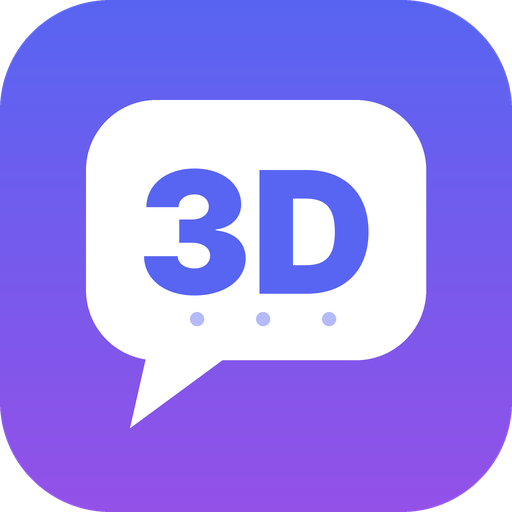

# 3DScord (español)

[English version](README.md) · [Wiki](https://github.com/IkerPlays/3DScord/wiki) · [Descargas](https://github.com/IkerPlays/3DScord/releases/latest)

**Un cliente de Discord para la Nintendo 3DS.** Chat, llamadas de voz, tu cámara, compartir pantalla, tu perfil y tus servidores, en las dos pantallas.

3DScord es una bifurcación (fork) de [TriCord](https://github.com/2b-zipper/TriCord) de 2b-zipper (GPLv3), mantenida por IkerPlays.

> **Aviso.** Es un cliente no oficial hecho con fines educativos. No está afiliado ni respaldado por Discord Inc. ni por Nintendo. Úsalo bajo tu
> responsabilidad: Discord no da soporte a clientes de terceros y los autores no se hacen responsables de pérdidas de datos, problemas con tu cuenta ni
> incumplimientos de las condiciones de Discord.

## Qué hace

- **Inicio de sesión:** código QR, correo y contraseña, o un archivo `token.txt`; varias cuentas con cambio rápido.
- **Chat:** texto, emojis, archivos adjuntos, embeds, stickers, reacciones, respuestas, editar y borrar, spoilers, encuestas, GIF / APNG / Lottie, fijar mensajes,
  **menciones** (escribe `@nombre` y se envía como mención real) y mensajes de voz.
- **Servidores:** lista con carpetas, canales, foros, mensajes directos y grupos.
- **Voz:** canales de voz y llamadas con cifrado de extremo a extremo (DAVE), volumen por persona, pulsar para hablar y cancelación de eco.
- **Vídeo (experimental, New 3DS / New 2DS XL):** ver la cámara y la pantalla compartida de los demás, enviar tu cámara delantera o trasera y **compartir pantalla (Go Live)**:
  la pantalla de arriba, la de abajo o las dos, incluso desde el menú HOME u otras aplicaciones, y a la vez que la cámara. También puedes ver el directo de otra persona.
- **Audios y vídeos:** reproduce Opus, MP3, WAV, FLAC y Ogg Vorbis desde el chat, y vídeos MP4 (H.264) sin sonido.
- **Notificaciones:** sonidos distintos para menciones, aviso de solicitudes de amistad, de batería baja y, con Luma3DS, notificaciones en el menú HOME y en el LED con la app en segundo plano.
- **Tu cuenta de Discord:** nombre, "Sobre mí", pronombres, color, avatar, banner, estado y estado personalizado, y ajustes de privacidad.
- **Temas e idiomas:** 13 temas (con alto contraste y apto para daltonismo), editor de temas, temas propios, formato de hora de 12/24 h, formato de fecha y modo para zurdos.
- **Actualizaciones dentro de la app** con las notas de cada versión, y versiones de desarrollo (devbuilds) opcionales.

## Consolas compatibles

| Consola | Chat y voz | Cámara, compartir pantalla y vídeo de los demás |
| --- | --- | --- |
| New Nintendo 3DS / 3DS XL, New 2DS XL | Sí | Sí |
| Nintendo 3DS / 3DS XL, 2DS | Sí | No (es demasiado lento: el ajuste se oculta) |
| Nintendo DS, DS Lite, DSi | No (no pueden ejecutar apps de 3DS) | No |

Necesita firmware personalizado (el probado es Luma3DS).

## Instalación

1. Descarga `3DScord.cia` o `3DScord.3dsx` de la [última versión](https://github.com/IkerPlays/3DScord/releases/latest). Con FBI también puedes usar *Remote Install > Scan QR Code* con el código QR de la versión.
2. **CIA:** instálalo con FBI. **3DSX:** cópialo a `/3ds/3DScord/` en la tarjeta SD y ábrelo desde el Homebrew Launcher.
3. Abre 3DScord e inicia sesión.

La app busca actualizaciones al arrancar, muestra las notas y se actualiza sola cuando aceptas.

> Si usabas TriCord, 3DScord mueve `sdmc:/3ds/TriCord` a `sdmc:/3ds/3DScord` en el primer arranque, así que conservas cuentas, ajustes y temas.

## Cómo iniciar sesión

- **Código QR:** escanéalo con la app de Discord del móvil (Ajustes > Escanear código QR).
- **Correo y contraseña:** escríbelos en la pantalla de abajo.
- **`token.txt`:** crea `sdmc:/3ds/3DScord/token.txt` con tu token (texto plano). La app lo lee, inicia sesión y borra el archivo.

> No compartas nunca tu token ni el archivo `accounts` de `/3ds/3DScord`: cualquiera de los dos da acceso a tu cuenta.

## Controles

| Botón | Acción |
| --- | --- |
| Cruceta / Stick | Moverse, desplazar |
| A | Seleccionar, abrir el menú del mensaje |
| B | Volver, cancelar |
| Y | Buscar dentro de Ajustes |
| SELECT | Abrir el menú lateral |
| START | Salir |
| L + R | Superposición de depuración / cambiar la vista de la llamada |

## Si algo falla

En **Ajustes > Diagnóstico**, haz lo que falla y pulsa **Y**: se guarda `sdmc:/3ds/3DScord/diagnostics.txt` con la versión, la memoria, la señal y las últimas líneas del registro.
Adjúntalo al [abrir una incidencia](https://github.com/IkerPlays/3DScord/issues/new/choose) (nunca pegues tu token).

## Compilar y contribuir

Mira [CONTRIBUTING.md](CONTRIBUTING.md) (en inglés) y la [wiki](https://github.com/IkerPlays/3DScord/wiki/Building-from-source). Las traducciones están en `romfs/lang/` y se agradecen.

## Créditos y licencia

Basado en [TriCord](https://github.com/2b-zipper/TriCord) de 2b-zipper. Licencia GNU GPLv3, ver [LICENSE](LICENSE). El logo y los sonidos son originales (`tools/brand/`).
