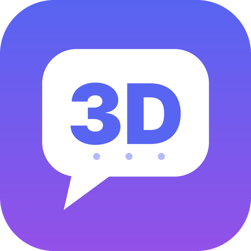

<p align="center"></p>

# 3DScord


[](https://github.com/IkerPlays/3DScord/actions/workflows/build.yml)
[](https://github.com/IkerPlays/3DScord/releases/latest)

**A Discord client for the Nintendo 3DS.** Chat, voice calls, your profile and your servers, on both screens.

3DScord is a fork of [TriCord](https://github.com/2b-zipper/TriCord) by 2b-zipper (GPLv3), maintained by IkerPlays.
See the [wiki](https://github.com/IkerPlays/3DScord/wiki) for guides, [ROADMAP.md](ROADMAP.md) for what is planned and [CHANGELOG.md](CHANGELOG.md) for what changed.

> **Disclaimer.** This is an unofficial client made for educational purposes. It is not affiliated with or endorsed by
> Discord Inc. You use it at your own risk: the authors are not responsible for data loss, account problems or
> violations of Discord's Terms of Service.

## Features

- **Login:** QR code, email/password, or a `token.txt` file; several accounts with quick switching.
- **Chat:** text, emoji, attachments, embeds, stickers, reactions, replies, edit and delete, spoilers, polls, GIF /
  APNG / Lottie animations, pin and unpin messages, jump to the message you replied to, reply with or without ping.
- **Servers:** server list with folders, channels, forum threads, direct messages and group chats.
- **Find and look up:** find a server or channel by name, search server members, open user profiles, create and join threads.
- **Right in the chat:** buttons for files (with a file browser and a preview before sending), GIFs, stickers, pinned
  messages, search and voice. **Channel Tools** has the rest: gallery, threads, members, quick replies, drafts,
  formatting, sounds and mark as read. Saved messages, mentions, friends and voice are in the side menu (Quick Access).
- **Voice:** voice channels and calls with end-to-end encryption (DAVE), mic and per-user volume. With the experimental Video setting
  on, the camera or shared screen of someone in the call is decoded in software and shown on the top screen, and you can send your own
  inner or outer camera, or share the top screen as a Go Live stream (H.264 encoded on the console).
- **Videos:** MP4 attachments (H.264, up to 1280x720 and 16 MB) play without sound from the message menu (experimental).
- **Your Discord account (Settings):** display name, About Me, pronouns, profile color, avatar and banner (from files on
  the SD card), status and custom status, message display options and privacy options.
- **Auto-updater:** at startup, while the 3DScord logo spins, 3DScord looks for a new version. It shows the release
  notes, asks if you want to update, installs it and restarts. Devbuilds are optional.
- **Themes and languages:** 13 themes (Dark, Light, AMOLED, Nintendo, Retro, Midnight, Sunset, Ocean, Forest, Rose, High contrast, Colour-blind friendly and Paper), a theme editor on the console,
  custom [themes](THEME_FORMAT.md) and several languages. Left-handed mode and a battery saver.
- Goes idle automatically when you close the lid.

## Compatible consoles

| Console | Chat and voice | Camera, screen sharing and other people's video |
| --- | --- | --- |
| New Nintendo 3DS / 3DS XL, New 2DS XL | Yes | Yes |
| Nintendo 3DS / 3DS XL, 2DS | Yes | No (too slow: the setting is hidden) |
| Nintendo DS, DS Lite, DSi | No (they cannot run 3DS apps) | No |

It needs custom firmware (Luma3DS is the tested one).

## Installation

1. Download `3DScord.cia` or `3DScord.3dsx` from the [latest release](https://github.com/IkerPlays/3DScord/releases/latest).
2. **CIA:** install it with FBI. **3DSX:** copy it to `/3ds/3DScord/` on the SD card and start it from the Homebrew Launcher.
3. Start 3DScord and log in.

Updates are then offered inside the app. The CIA restarts by itself after updating; the 3DSX has to be started again
from the Homebrew Launcher.

> If you used TriCord before, 3DScord moves your `sdmc:/3ds/TriCord` folder to `sdmc:/3ds/3DScord` on first start, so
> your accounts, settings and themes are kept.

### Releases

| Kind | What it is |
| --- | --- |
| **Stable** (`v0.2.0`) | Tested versions. Every second devbuild cycle ends in one. |
| **Devbuild** (`v0.2.1-dev.12`) | Work in progress, published after each finished phase of the roadmap. Turn on **Settings > Updates > Include Devbuilds** to receive them. |

### Login methods

- **QR code:** scan it with the Discord mobile app.
- **Email / password:** type them on the bottom screen.
- **`token.txt`:** create `sdmc:/3ds/3DScord/token.txt` with your token (plain text, no extra whitespace). The app reads
  it, logs in and deletes the file.

> Never share your Discord token or the `accounts` file in `/3ds/3DScord`. Either one gives access to your account.

## Your Discord settings

Open **Settings** (menu > gear). When you are logged in you get **Discord Profile**, **Discord Status**,
**Discord Chat** and **Discord Privacy** sections. To change your avatar or banner, choose the picture in the file browser that opens (a `png`, `jpg` or `gif`
up to 1.5 MB). Banners need Discord Nitro.

## Controls

| Button | Action |
| --- | --- |
| D-Pad / Circle Pad | Move, scroll |
| A | Select, open the message menu |
| B | Back, cancel |
| Y | Search inside Settings |
| SELECT | Open the side menu |
| START | Exit |
| L + R | Debug overlay |

## Building from source

You need [devkitPro](https://devkitpro.org/wiki/Getting_Started) with devkitARM, plus `makerom` and `bannertool` for
the `.cia`.

```bash
git clone https://github.com/IkerPlays/3DScord.git
cd 3DScord
make -j$(nproc)
```

Output: `3DScord.3dsx`, `3DScord.cia` and `3DScord.elf`.

GitHub Actions builds every push (`.github/workflows/build.yml`). Run that workflow by hand to publish a devbuild, or
**Stable release** to publish a stable one.

## Libraries

devkitPro: libctru, citro3d, citro2d, libcurl, mbedTLS, zlib. Bundled in `library/`: rapidjson, stb_image, qrcodegen,
ThorVG, Opus, WebRTC AECM, MLSPP and libdave. The license texts are in [romfs/licenses](romfs/licenses) and are
embedded in the `.3dsx` and `.cia`.

## Resumen en español

3DScord es un cliente de Discord para la Nintendo 3DS, basado en TriCord. Incluye chat, voz, ajustes de tu cuenta de
Discord (perfil, avatar, banner, estado), actualizaciones dentro de la app con notas de la versión, y un
[plan de desarrollo](ROADMAP.md) por fases. Instálalo con el `.cia` (FBI) o el `.3dsx` (Homebrew Launcher) desde
[Releases](https://github.com/IkerPlays/3DScord/releases).

## Credits and license

Based on [TriCord](https://github.com/2b-zipper/TriCord) by 2b-zipper. Licensed under the GNU GPLv3, see [LICENSE](LICENSE).
