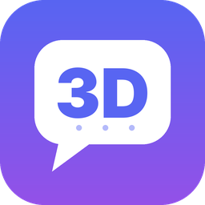

# 3DScord

**A Discord client for the Nintendo 3DS.** Chat, voice calls with end-to-end encryption, your camera and screen sharing (Go Live), on both screens.

3DScord is free and open source (GPLv3) and a fork of [TriCord](https://github.com/2b-zipper/TriCord) by 2b-zipper.

## Start here

| I want to... | Page |
|---|---|
| Install it | [[Installation]] |
| Log in and learn the controls | [[First steps]] |
| Know what the console models can do | [[Compatibility]] |
| Chat, reply, mention, send voice messages | [[Chat]] |
| Use voice, the camera and screen sharing | [[Voice and video]] |
| Get notifications | [[Notifications]] |
| Change settings and themes | [[Settings and themes]] |
| Fix a problem | [[Troubleshooting]] |
| Build it myself | [[Building from source]] |
| Read the questions people ask | [[FAQ]] |

## Links

- [Latest release](https://github.com/IkerPlays/3DScord/releases/latest) and [all releases](https://github.com/IkerPlays/3DScord/releases)
- [Changelog](https://github.com/IkerPlays/3DScord/blob/main/CHANGELOG.md) and [roadmap](https://github.com/IkerPlays/3DScord/blob/main/ROADMAP.md)
- [Report a problem or an idea](https://github.com/IkerPlays/3DScord/issues)

> **Disclaimer.** 3DScord is an unofficial, fan-made client. It is not affiliated with or endorsed by Discord Inc. or Nintendo. Discord does not support
> third-party clients: use it at your own risk, and never share your token.
